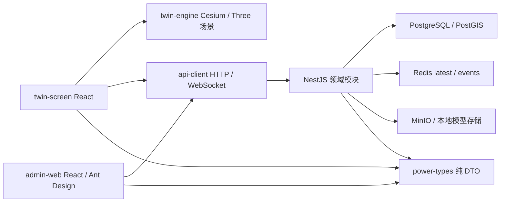

# 方案 B 架构落地

依据归档中的详细架构原文实施，不把参考文档中的示例密码、命令或后续阶段建议当作用户的独立操作授权。

## 依赖边界

`apps` 之间不互相导入。`twin-engine` 不读取 Zustand 或后端内部实现；由调用方注入状态与业务拾取回调。`shared-utils` 提供演示夹具及纯函数；`power-types` 不导入 React/Cesium/Nest。后台 CRUD 页面定义拆到各业务目录，公共表格负责表单、错误、分页和缓存失效。

## 领域与实现

| 领域 | 实现目录 | 核心能力 |
| --- | --- | --- |
| 认证 | api-server/src/modules/auth | scrypt 密码、15 分钟访问令牌、7 天轮换 HttpOnly Cookie、权限与区域范围 |
| 用户 | modules/users | 账户创建、角色更新、区域授权 |
| 资产 | modules/assets | 独立区域/资产/线路、引用保护、视域 GeoJSON |
| 拓扑 | modules/topology | 节点/边/开关状态，闭合边方向追踪、路径与版本发布 |
| 遥测 | modules/telemetry | 单一串行模拟时钟、测点采样、最新值、分区历史 |
| 告警 | modules/alarms | 确认、恢复与人工关闭分离，规则活动告警唯一约束 |
| 保电 | modules/protection | 活动、目标资产、预案、未闭环工单阻止归档 |
| 工单 | modules/work-orders | 幂等创建、版本校验、指派/开始/提交/复核、操作日志 |
| 场景 | modules/scenes | GLB 签名上传、资产绑定、镜头、配置与发布快照 |

Nest 动态领域模块通过 provider 生命周期注册 Fastify 适配器路由，统一异常过滤器管理错误。数据库迁移在 advisory lock 下执行，业务修改用独立连接事务。生产使用 PostgreSQL，SQLite 仅用于仓储隔离测试。

## 实时与一致性

服务端持有唯一模拟时钟；公共推进与控制排队串行执行。每秒采样测点、写入最新值/历史、评估规则并提交快照。WebSocket 先认证再推送，支持测点订阅、心跳、慢客户端断开、会话到期断开。客户端指数退避重连、重新订阅、HTTP 完整快照恢复、domain 序列去重，断线保留最后快照并显示连接异常。

模型绑定使用 scene_bindings 关联，不改写资产基础表。发布操作原子保存模型绑定快照并递增目录版本，广播新目录。大屏按资产 ID 加载已发布模型；场景配置草稿与发布快照分别保存。

## 权限

管理员全域管理；保电管理员管理活动；主管管理告警与工单；运维人员处理指派给本人的工单；大屏用户只读。实际写权限从 roles.permissions 查询，内置管理员和系统管理仍有后端硬约束。区域授权为空表示全域，有配置时包含下级区域，列表裁剪、资产详情/写入与 WebSocket 推送均受约束。区域受限账户不能进入跨域拓扑、报告、场景和活动管理。

## 当前工程边界

基础台账使用可验证的小规模种子，扩展种子命令提供 12 站/300 设备/120 线/800 测点。尚未连接真实电网采集、视频流或真实 GIS/BIM；不声称满足生产可靠性、目标 FPS 或两小时资源稳定性指标。通用资产批量导入和完整场景编辑器不包含在当前界面中。
