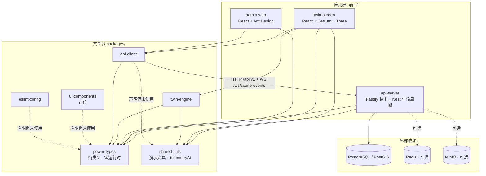
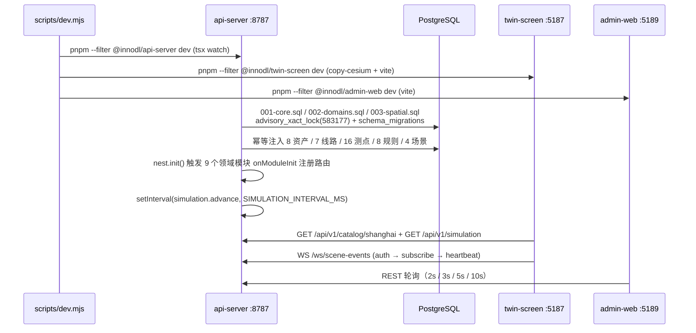
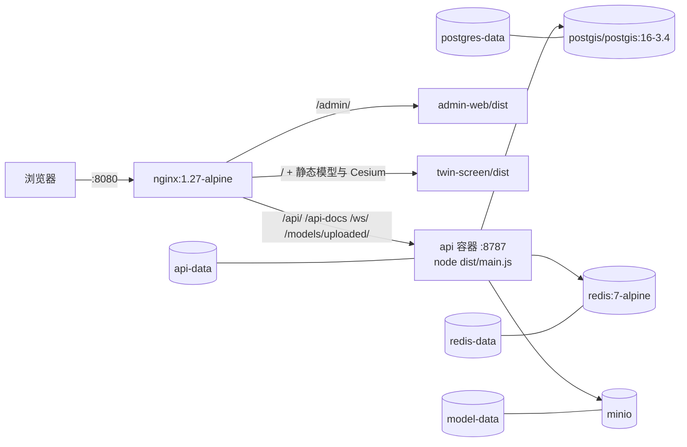

# 02 · 总体架构文档

> 全景智慧供电保障系统（方案 B · 可运营 MVP）
> 分析基准：`InnoDLSystem/code/` 2026-11-04 代码快照；路径均相对 `code/`。

## 1. 系统定位与组成

一个 **pnpm Monorepo**（`packageManager: pnpm@10.11.0`，`type: module`），由 3 个独立应用、6 个共享包、2 个工具包和 5 类支撑设施构成，实现「保电任务配置 → 三维场景加载 → 状态监测 → 异常告警 → 故障定位 → 工单处置 → 恢复确认 → 事件归档」的纵向闭环。

| 层 | 成员 | 职责 |
| --- | --- | --- |
| 展现层 | `apps/twin-screen`（5187）、`apps/admin-web`（5189） | 三维指挥大屏、综合业务后台；**两者互不导入** |
| 网关/服务层 | `apps/api-server`（8787） | 统一 REST + WebSocket + 静态托管 + 领域业务 |
| 能力层 | `packages/twin-engine`、`packages/api-client` | Cesium 渲染内核、HTTP/WS 客户端 |
| 契约层 | `packages/power-types`、`packages/shared-utils` | 纯类型契约、演示夹具与确定性遥测公式 |
| 工程层 | `packages/eslint-config`、`packages/ui-components` | 代码规范；后者为占位包 |
| 工具层 | `tooling/mock-telemetry`、`tooling/model-converter` | NDJSON 样例输出、GLB 生成 |
| 支撑设施 | `database/`、`infra/`、`scripts/`、`tests/`、`assets/` | 迁移与种子、容器、启动脚本、测试、三维资产 |

工作区声明 `pnpm-workspace.yaml`：`apps/*`、`packages/*`、`tooling/*`。根 `turbo.json` 只定义 `build`（`dependsOn: ["^build"]`）与 `typecheck`（`dependsOn: ["^typecheck"]`）两条任务。

## 2. 全局依赖拓扑



依赖规则与方案 B 原文一致且有代码证据：

- `apps` 之间零导入；`api-server` 不依赖任何前端应用。
- `power-types` 是**唯一无 workspace 依赖的叶子**，是全仓契约中心（3 个 app + 5 个包/tooling 引用它）。
- `twin-engine` 不依赖 `api-client`，不发任何网络请求；通过 `EngineBindings { getState, select }` 与业务解耦。
- 所有内部依赖版本均为 `workspace:*`；**包 `exports` 一律指向 `src/index.ts`（TS 源码直出）**，`dist/` 只是 `turbo run build` 的并行产物，全仓无任何 import 指向 `dist/`。
- 包间依赖图有向无环；唯一的环是 `power-types` 内部 `index.ts ↔ contracts.ts` 的**类型级双向引用**（`import type` / `export type *`，编译后擦除，`dist/index.js` 为 0 B）。

## 3. 运行时数据流

### 3.1 启动链路



### 3.2 三条核心数据链路

**① 台账写入 → 三维同步（REST → catalog 广播）**

```
后台 ResourcePage 表单 → api-client.request() → POST /api/v1/assets
  → zod 校验 → repository.saveAsset()（事务 + 审计 + revision+1）
  → publishCatalog() → broadcast({type:'catalog', data: SceneCatalog})
  → 大屏 useSceneData 收到 catalog → zustand set({catalog})
  → CityScene 的 useStore.subscribe → scene.sync()
  → 注：catalog.revision 变化会改变 CityScene 的 key，重建 Cesium Viewer
```

**② 模拟时钟 → 告警 → 定位 → 工单（唯一权威时钟在服务端）**

```
setInterval(1000) → simulation.advance()（serial() 串行化）
  → snapshotAt(tick) = telemetryAt(tick)（shared-utils 确定性公式）
  → measurements.sample()：写 telemetry_latest / telemetry_history，
     按 alarm_rules 评估阈值 → 生成/恢复 alarms → 推送 alarm.created / alarm.updated
  → repository.record(snapshot, tick)
  → broadcast({type:'telemetry'}) + broadcast({type:'domain'})
  → 大屏告警自动定位；后台轮询列表；工单状态机 assign→start→submit→review
```

**③ 模型上传 → 绑定 → 发布 → 加载（三步签名上传）**

```
POST /api/v1/scene-models/upload-url → {id, url(HMAC,5min)}
  → PUT /api/v1/model-upload/:id（鉴权豁免，靠签名 + GLB 魔数/长度校验）
  → POST /api/v1/scene-models/:id/complete
  → PUT /api/v1/scenes/:sceneId/bindings
  → POST /api/v1/scenes/:id/publish（写 app_state 发布快照 + 广播 catalog）
  → 大屏 twin-engine.resolveModelBindings() → Cesium model entity
```

无 MinIO 时降级为本地 `data/models/<uuid>.glb`，由 `GET /models/uploaded/:file` 提供；Vite / Nginx 均把 `/models/uploaded/` 反代到 API。

### 3.3 认证与权限

- **不是 JWT**：`scrypt` 加盐密码哈希（`salt:hash`）、`randomBytes(32)` 不透明令牌，数据库 `sessions` 表只存 SHA-256 `token_hash`。
- 访问令牌 15 分钟；`innodl-refresh` HttpOnly Cookie 7 天，`Path=/api/v1/auth`，一次性轮换。
- 鉴权不在路由装饰器里，而是 `auth/base.routes.ts` 的**全局 `onRequest` 钩子**（URL 子串推断 domain → 查 `roles.permissions`）+ `auth/scope.ts` 的 `preHandler` / `preSerialization` 区域裁剪。
- 5 种角色：`admin` / `protection_manager` / `supervisor` / `operator` / `viewer`；`user_scopes` 为空表示全域授权，有配置时沿 `regions.parent_id` 递归展开子区域。
- WebSocket 连接后 5 秒内必须发 `{event:'auth', token}`，否则 `close(1008)`；按 `socketScopes` 裁剪推送。
- 前端**没有**路由守卫或按角色隐藏菜单，权限完全由后端执行。

## 4. 技术栈真相（与直觉/描述的差异）

| 主题 | 常见理解 | 代码事实 |
| --- | --- | --- |
| 后端框架 | 「NestJS 应用」 | **Fastify 作肉、Nest 作壳**：`FastifyAdapter.getInstance()` 得到原生 `FastifyInstance`，全部 88 条路由由 `registerXxxRoutes(app, ...)` 原生注册；无 `@Controller` / `@Injectable` / Guard / Pipe。Nest 仅用于 ① `nest.init()` 触发 9 个 `onModuleInit` 闭包注册路由，② `useGlobalFilters(ApiExceptionFilter)` 把全局异常处理器装到 Fastify。9 个 `.module.ts` 全是空壳。 |
| ORM | 「Prisma 管理数据」 | Prisma 只有 `MeasurementPoint`、`AlarmRule` **2 个 model**，且只做读取映射，不负责建表；其余全为 `pg` 原生 SQL / `node:sqlite`。 |
| Cookie / CORS | 「用 @fastify/cookie、@fastify/cors」 | 两个依赖**都不存在**；Cookie 手工 `split(';')` 解析与 `Set-Cookie` 拼接；**CORS 完全未配置**，只能同源或经代理。 |
| 数据库 | 「PostgreSQL 唯一」 | 三适配器：`postgres.ts`（生产，独立业务表）、`extended.ts`（增量迁移与回填）、`sqlite-test.ts`（`node:sqlite`，`document` JSON 列，仅供仓储隔离测试）。设置 `DATABASE_FILE` 时 **17 个注册器被 `if (pg)` 跳过**，仅目录/资产/线路 CRUD 与监测快照路由存在，WS 免鉴权。 |
| 前端路由 | 「React Router 路由表」 | 两个 app 都**没有** `<Routes>` / `<Route>`。大屏用 `useTwinRoute` 手工 `pathname.split('/')` 解析并写 zustand；后台用 `App.tsx` 中 6 个 `location.pathname === ...` 特判 + `resourceConfig()` 责任链。 |
| 模拟数据源 | 「mock-telemetry 是 WebSocket 服务」 | `tooling/mock-telemetry/server.mjs` 只有 6 行，向 stdout 一次性输出 NDJSON，**不监听端口、不推送、无定时器**。真实 WS 在 `api-server`。 |
| 缓存 | 「Redis 缓存」 | `REDIS_URL` 未配置时 `createCache` 直接返回 `undefined`，**无内存降级**；即使配置了，代码也只 publish 不 subscribe，跨实例广播未闭环。 |
| Swagger | 「自动接口文档」 | 注册了 swagger/swagger-ui，但原生路由**未配置任何 Fastify `schema`**，OpenAPI 里不会出现业务接口。 |
| `ui-components` | 「共享组件库」 | 10 行、单函数 `connectionPresentation`，无 JSX、无 React 组件、`apps/` 零引用，是占位包。 |

### 主要版本与端口

| 技术 | 版本 / 位置 |
| --- | --- |
| React / TypeScript | 18.3.1 / ~5.4.5 |
| Vite | ^6.1.0（`@vitejs/plugin-react` ^4.7.0） |
| Cesium / Three.js | 1.132.0（固定）/ ^0.180.0 |
| 状态 / 数据 | zustand ^5.0.8、@tanstack/react-query ^5.90.0 |
| 后台 UI | antd ^6.0.0、@ant-design/icons ^6.0.0、echarts ^6.0.0、react-router-dom ^6.30.1 |
| 大屏 UI | styled-components ^6.1.19（仅 `Panel.tsx` 使用）、lucide-react、自绘 SVG 图表 |
| 后端 | fastify ^5.6.2（pnpm overrides 锁 5.11.3）、@nestjs/* ^11.1.0、zod ^4.1.0、pg ^8.16.3、@prisma/client 6.19.0 |
| 构建 | tsup ^8.5.0、turbo ^2.5.8、vitest ^3.2.4、@playwright/test ^1.56.0 |
| 规范 | eslint ^9.39.0（flat config + eslint-plugin-jsdoc）、prettier ^3.6.2、husky ^9.1.7、lint-staged ^16.2.0 |

| 端口 | 用途 |
| --- | --- |
| 5187 | 大屏（固定，`strictPort`） |
| 5189 / 5198 | 后台开发 / E2E 后台 |
| 8787 / 8790 | API 开发 / E2E API |
| 8080 | 容器 Nginx 统一入口 |
| 127.0.0.1:55432 | Compose 中 PostGIS 宿主映射 |

## 5. 数据与存储

- **迁移双轨但职责分离**：`001-core.sql` 建 16 张表 + 1 索引；`002-domains.sql` 新建 17 张表（含 `telemetry_history` 分区表 + 默认分区）、加列与部分唯一索引 `alarms_one_active_rule`；`003-spatial.sql` 仅在检测到 PostGIS 可用时执行，添加 `assets.location geometry(Point,4326)` + GiST 索引 + 同步触发器。
- **三个 SQL 全部是纯 DDL，不含 INSERT**。种子由 `postgres.ts` / `extended.ts` 在 `pg_advisory_xact_lock(583177)` 事务内按 `schema_migrations.version=1` 幂等注入。
- 时间戳统一 `bigint`（毫秒），主键多为 `text`，业务详情用 `jsonb` 文档列；`work_orders.version` 做乐观锁，`Idempotency-Key` 配合 advisory lock 做幂等创建。
- 演示扩展 `database/seed/demo.sql`：12 站 / 300 设备 / 120 线 / 800 测点，固定 `demo-*` 编码 + `ON CONFLICT DO NOTHING`；但 `app_state` 递增与 `audit_log` 插入每次执行都会累积。
- 详见 [20 · 数据库](20-支撑-数据库.md)。

## 6. 部署拓扑



`infra/Dockerfile` 三阶段：`build`（pnpm install → `db:generate` → `ENV ADMIN_BASE=/admin/` → `pnpm build`）派生出 `api` 与 `nginx` 两个 target。`compose.yaml` 中 postgres/redis 有健康检查，api 依赖二者 `service_healthy` 与 minio `service_started`，nginx 依赖 api `service_healthy`；minio 与 nginx 自身无健康检查。

开发态则由两个 Vite dev server 代理 `/api`、`/models/uploaded`、`/ws` 到 `API_PROXY_TARGET`（默认 `http://localhost:8787`），`api-server` 同时用 `@fastify/static` 托管 `apps/twin-screen/dist`（仅当该目录存在 `index.html` 时）。**admin-web 不由 api-server 托管**。

## 7. 与方案 B 原文的可核验偏差

参考 `source/全景智慧电力保障系统_对话归档/documents/方案B_详细架构原文.md`（14 章 / 1276 行）与 `plan.md`：

| 维度 | 方案 B 原文 | 实际落地 |
| --- | --- | --- |
| 端口 | 大屏 :3000 / 后台 :3001 / API :3002 | 5187 / 5189 / 8787 |
| 后端 | NestJS + Prisma ORM | Fastify 原生路由 + Nest 生命周期壳；Prisma 仅 2 表映射 |
| 数据表 | 27 张 `sys_*`、UUID 主键、通用 `created_at/updated_at` | 001 建 16 张 + 002 建 17 张，复数小写 `text` 主键、`bigint` 时间戳 |
| 种子规模 | 3 活动 / 20 规则 / 10 故障案例 / 8–12 镜头 | 基础种子 1 活动 / 8 规则 / 每场景 1 镜头；`demo.sql` 补 12/300/120/800 |
| 三维 SDK | `ITwinEngine` 9 方法 + SceneRouter/TourController 等 11 模块 | `twin-engine` 公开 6 个符号，`createCity` 一个函数承担主要渲染；设备场景 Three.js 在 app 层 |
| 后台页面 | 约 23 个路由页 | 手写路径分发 + 配置驱动 `ResourcePage`，10 个一级菜单 |
| 样式 | plan.md 注释建议 Styled Components（**该段被 HTML 注释包裹，未生效**） | admin-web 用 Ant Design + 单文件 CSS；twin-screen 仅 `Panel.tsx` 用 styled-components，其余 1838 行全局 CSS |

**plan.md 五条开发要求的落地证据**：React + TS（两个 Vite 配置）、pnpm Monorepo + 共享类型（`power-types` 被前后端共同引用）、ESLint/Prettier/Husky（`eslint-config`、`lint-staged`、`.husky/pre-commit`）、逐参数 `@param` + `@returns`（`eslint-plugin-jsdoc` 五项规则设为 error，源码普遍带完整 JSDoc）、模块化解耦（3 apps + 9 领域模块 + 依赖边界文档）。

## 8. 架构评价与已知边界

**做得好的部分**

- 契约中心明确：`power-types` 零运行时，被全部应用共享；`exports` 指向源码让 monorepo 开发无需预构建。
- 引擎与业务解耦：`twin-engine` 只通过 `getState` / `select` 连接，不发请求、不读 zustand。
- 服务端单一权威时钟 + 串行推进，避免多端各自造数据；WS 有认证、订阅、心跳、慢客户端断开、`seq` 去重、指数退避重连。
- 迁移与种子幂等（`advisory lock` + 版本表），测试三层隔离（SQLite 内存、PG 专属 schema、E2E 专属 schema）。
- 资源释放意识强：`createDisposer` 逆序幂等销毁、Three.js `disposeObject`、Cesium `viewer.destroy()`、ResizeObserver / ECharts 实例均显式 dispose。

**主要风险（按影响排序）**

1. **Nest/Fastify 隐式耦合**：`nest.init()` 同时承担路由注册与全局异常过滤器安装，依赖 `node_modules` 内部 `onModuleInit` 鸭子类型与 `FastifyAdapter.setErrorHandler` 行为。移除 Nest 会让 88 条路由全部消失，且这一约束只体现在 `modules.ts`，无显式测试保护。
2. **权限靠 URL 字符串推断**：`route.includes('/alarm')` 之类规则，新增路由若不落入既有模式即可能漏鉴权；`/api/v1/model-upload/` 是显式豁免，`GET /models/uploaded/:file` 因不在 `/api/v1/` 前缀下完全不受鉴权。
3. **CORS 缺失**：独立跨域部署后台将直接失败，当前强依赖同源/Vite 代理。
4. **前端两个单体**：`twin-screen/src/app/App.tsx` 891 行 + `global.css` 1838 行；`App` 用 `useStore()` 无 selector 订阅整个 store，每秒 tick 会重渲染整棵树；`admin-web/App.tsx` 257 行同时承担登录页、框架、路由分发。
5. **无声明式路由**：两个 app 均无路由表、无 404、无懒加载、无 ErrorBoundary；新增页面需同时改导航、`App.tsx`、领域配置三处。
6. **数据一致性边界**：`createCity` 初始化时一次性解构 `assets/lines` 建实体，`sync()` 只更新显隐属性；catalog 增删资产时几何不会增减，只能靠 `revision` 改 key 重建 Viewer。
7. **演示值硬编码**：大屏日期/天气/坐标/99.99 三个 Gauge/LoadChart 的 24 点常量、后台跨应用地址 `http://localhost:5187/...`、`station-a-temperature` 默认测点等，均写死在组件里。
8. **半成品能力**：Redis 只 publish 不 subscribe（多实例广播未闭环）、`telemetry_history` 只有 DEFAULT 分区、Swagger 无业务 schema、`/topology/paths` 的 `from/to` 与 `node-xxx` 节点标识语义不一致、`ui-components` 与多个依赖声明未被使用。
9. **文档断链**：`code/docs/acceptance.md` 指向不存在的 `testing/验收记录.md`；`docs/api/README.md` 漏列 14 条实际路由且未说明 SQLite 模式降级。

> 完整的逐子项目缺口清单见各子项目文档末尾的「设计取舍与已知缺口」；`code/README.md` 自身也明确声明不声称满足生产可靠性、目标 FPS 或两小时资源稳定性指标。
