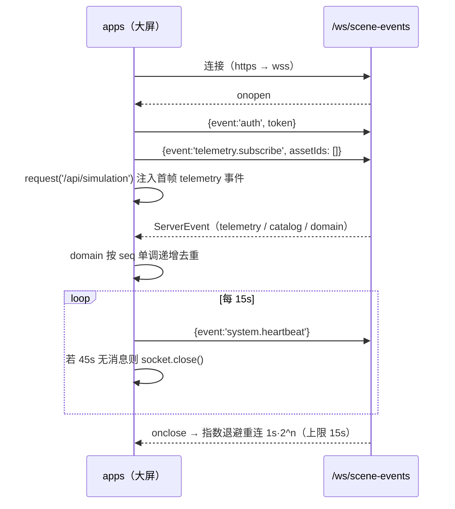

# 07 · 子项目代码架构：`@innodl/api-client`

> 路径：`packages/api-client/` · 定位：前后端共用 HTTP / WebSocket 客户端 · 单文件 `src/index.ts`（244 行）
> 依赖：`@innodl/power-types`（type-only）、`@innodl/shared-utils`（**声明但未使用**）；`exports: "./src/index.ts"`

## 1. 模块级状态与请求封装

```ts
let refreshing: Promise<string> | undefined;   // 刷新令牌并发去重
```

**私有 `send<T>(path, options, allowRefresh, preservePage=false)`**：

1. **路径规范化**：`path.startsWith('/api/v1/') ? path : path.replace(/^\/api\//, '/api/v1/')` —— 所有调用方写的 `/api/xxx` 实际请求 `/api/v1/xxx`。**无 baseURL 常量**，使用同源相对路径。
2. `fetch(url, {credentials:'include', headers:{Authorization: Bearer <sessionStorage['innodl-token']>, 'Content-Type':'application/json'（仅当有 body）, ...options.headers}})`。
3. **401 刷新**：命中且 `allowRefresh` 且非 `/auth/(login|refresh)` 且 `signal` 未 abort → `await refreshSession()` → 递归 `send(..., false, ...)` **只重放一次**。
4. 错误处理：`!response.ok → throw new Error(envelope.error?.message ?? envelope.message ?? '接口异常：'+status)`。
5. **自动解包**：取 `envelope.data`；若 `!preservePage` 且 `data` 含 `items` → 返回 `data.items`（列表透明解包）；`requestPage` 传 `preservePage=true` 保留 `{items,total,page,pageSize}`。

`refreshSession()`：`POST /api/v1/auth/refresh`（`credentials:'include'`），成功写回 `sessionStorage`，失败 `removeItem` 并抛错；`refreshing` 单例 Promise 避免并发刷新。

## 2. 导出 API（12 个）

| 导出 | 实际请求 | 说明 |
| --- | --- | --- |
| `refreshSession()` | `POST /api/v1/auth/refresh` | 刷新访问令牌 |
| `request<T>(path, options?)` | 参数传入 | 通用请求（自动解包 `items`） |
| `requestPage<T>(path)` | 参数传入 | 保留分页结构 |
| `fetchScene()` | `GET /api/v1/catalog/shanghai` | 场景目录 |
| `fetchReplay(tick, signal?)` | `GET /api/v1/telemetry/replay?tick=N` | 只读回放快照 |
| `subscribeScene(onEvent, onStatus)` | `WS /ws/scene-events` | 实时订阅，返回清理函数 |
| `saveAsset(asset, create)` | `POST /api/v1/assets` / `PUT /api/v1/assets/:id` | 大屏数据维护 |
| `saveLine(line, create)` | `POST /api/v1/power-lines` / `PUT /api/v1/power-lines/:id` | 同上 |
| `deleteResource(kind, id)` | `DELETE /api/v1/{assets\|power-lines}/:id` | 同上 |
| `fetchAlarms()` | `GET /api/v1/alarms` | 告警列表 |
| `acknowledgeAlarm(id, note)` | `POST /api/v1/alarms/:id/acknowledge` | 告警确认 |
| `fetchAudit()` | `GET /api/v1/audit` | 审计日志 |

> 后台 `admin-web` 的业务端点（`/api/users`、`/api/protection-events` 等约 30 个）**不在此包封装**，而是各页面直接调 `request(path)`；本包只提供传输层与大屏专用的业务方法。

## 3. WebSocket `subscribeScene` 实现



- `onmessage`：`JSON.parse` 为 `ServerEvent`，接受 `domain` / `catalog` / `telemetry`（且 `Number.isInteger(event.data.tick)`）；解析失败 `catch {}` **静默忽略**。
- `onopen` 主动 `request('/api/simulation')` 取初始快照回灌，保证断线重连后状态完整。
- 清理函数：清 watchdog、`disposed=true`、清 timer、把 `onopen/onmessage/onerror` 置 null（**保留 onclose** 以清连接级陈旧检测定时器）、`socket.close()`。

## 4. 数据模式边界

**本包不区分 server/offline**：全文无 `VITE_DATA_MODE` 判断，唯一的 `isDemoData:true` 是 `subscribeScene` 构造初始事件时的硬编码常量。

区分发生在**应用层**：`apps/twin-screen/src/hooks/useSceneData.ts:7` 的 `const offline = import.meta.env.VITE_DATA_MODE === 'offline'`：

| | server（默认） | offline |
| --- | --- | --- |
| 目录 | `fetchScene()` | `Promise.resolve(useStore.getState().catalog)` |
| 连接 | `connection` 由 `onStatus` 更新，建 WS | 直接 `set({connection:'offline'})`，不建 WS |
| 遥测 | WS 推送 + `/api/simulation` 首帧 | `setInterval(1000)` 本地 `telemetryAt(tick)` |
| 回放 | `fetchReplay(tick)` | `telemetryAt(tick)` |
| 写操作 | 可用 | 被 `OperationsPanel` 的 `connection !== 'online'` 禁用 |

## 5. 设计取舍与已知缺口

1. **路径静默重写**：调用方看到 `/api/...`，实际发 `/api/v1/...`；服务器端 `app.ts` 的 `rewriteUrl` 又做一次同款重写。两处约定分散，排查问题时容易误判。
2. **双重首帧请求**：`subscribeScene` 的 `onopen` 与 `useSceneData.ts` 各请求一次 `/api/v1/simulation`，正常在线路径该接口被调用两次。
3. **静默吞错**：WS 消息解析失败、坏消息过滤均 `catch {}`；无日志、无上报。
4. **Token 存 `sessionStorage`**：刷新页面可保留（同标签页），但新标签页需重新登录；XSS 可读（非 HttpOnly）。`refreshSession` 失败后仅清 token，不主动通知应用跳转，依赖 `user.isError` 间接触发。
5. **业务方法与传输层混装**：`saveAsset` / `fetchAlarms` 等大屏专用方法混在通用客户端里，后台完全不用，导致包职责不单一。
6. **未使用依赖**：`package.json` 声明 `@innodl/shared-utils`，源码零 import。
7. **无请求取消/超时的统一策略**：仅 `fetchReplay` 接受 `AbortSignal`；无全局 timeout、无重试（除 401 一次）、无并发去重（除 refresh）。
8. **`exports` 指向 src**：`dist/index.js` 与 `dist/index.d.ts` 仅为 `turbo build` 产物，无消费者；若将来切换 exports 到 dist，需同步处理 `power-types` 空 JS 产物与 `twin-engine` 的外部依赖。
9. **类型边界**：`send<T>` 返回泛型 `T`，但自动解包 `items` 的行为不在类型系统里体现，调用方容易把分页对象误当数组（所以才另设 `requestPage`）。
