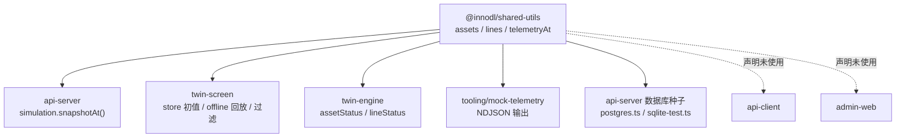

# 09 · 子项目代码架构：`@innodl/shared-utils`

> 路径：`packages/shared-utils/` · 单文件 `src/index.ts`（219 行） · `exports: "./src/index.ts"`
> 依赖：`@innodl/power-types`（type-only）
> **定位纠正**：这不是普通工具函数库，而是**全仓唯一演示数据源 + 唯一确定性遥测公式**，前后端共用。

## 1. 导出（8 个）

| 导出 | 类型 | 说明 |
| --- | --- | --- |
| `assets` | `Asset[]` | 8 条硬编码演示资产：`venue`（国家会展中心）、`station-a`…`station-e`、`transport`、`hotel`，含 id/name/type/region/position/voltage/capacity/status |
| `lines` | `PowerLine[]` | 7 条硬编码线路 `line-a`…`line-g`（fromId/toId/voltage/load） |
| `regionNames` | `Record<RegionId,string>` | `{shanghai:'上海全网', core:'核心保电区', hongqiao:'虹桥枢纽区'}` |
| `filterAssets(region, type?)` | `(RegionId, AssetType?) => Asset[]` | 对**模块内 `assets` 常量**做区域 + 类型筛选，`region==='shanghai'` 放行全部 |
| `filterCatalogAssets(source, region, type?)` | `(Asset[], RegionId, AssetType?) => Asset[]` | 同逻辑，但接受外部传入数组（用于后端返回的 `SceneCatalog.assets`） |
| `telemetryAt(tick)` | `(number) => Telemetry` | **确定性遥测快照**（见下） |
| `assetStatus(assetId, telemetry)` | `(string, Telemetry) => Status` | 取该资产第一条告警的 `severity`，无则 `'normal'` |
| `lineStatus(line, telemetry)` | `(PowerLine, Telemetry) => Status` | 先看 `fromId` 状态，非 normal 即返回，否则返回 `toId` 状态 |

## 2. `telemetryAt` — 系统的数值真源

```ts
load    = 62.4 + Math.sin(tick / 13) * 4.2
voltage = 10.48 + Math.sin(tick / 7) * 0.08
current = 432 + Math.sin(tick / 11) * 23
timestamp = Date.UTC(2026, 10, 4, 1, 0, 0) + tick * 1000
active = tick % 90 >= 30 && tick % 90 < 55
alarms = active ? [{ id:`alarm-${floor(tick/90)}`, assetId:'station-a',
                     message:'诸光站 1# 柜温度偏高，请安排巡检',
                     severity:'attention', timestamp }] : []
```

即每 90 tick 一个周期，30–54 tick 产生温度关注告警，55 tick 自动恢复。这是演示闭环（告警 → 工单 → 复核关闭）的**确定性基础**：`tests/domain.test.ts` 遍历 3600 tick 校验 `load ∈ (58,67)`、`voltage > 10.3`、30 秒 attention / 55 秒 normal 可重放。

## 3. 消费方（全仓）



具体落点：

- `api-server/src/modules/telemetry/simulation.service.ts`：`snapshotAt(tick)` 用 `telemetryAt` 生成权威快照，再按 `repository.assets()` 过滤已删除资产的告警。
- `api-server/src/infrastructure/database/postgres.ts` / `sqlite-test.ts`：用 `assets` / `lines` / `regionNames` 注入基础种子。
- `twin-screen/src/stores/scene.store.ts`：catalog 与 `telemetryAt(0)` 初值；`useSceneData.ts` 的 offline 模式与回放。
- `twin-engine/src/scenes/createCity.ts`：`assetStatus` / `lineStatus` 决定 POI 与线路颜色。
- `tooling/mock-telemetry/server.mjs`：展开进 NDJSON 每行。
- `tests/domain.test.ts`：纯函数单测。

> `api-client` 与 `admin-web` 都在 `package.json` 声明了本包，但源码**零引用**。

## 4. 设计取舍与已知缺口

1. **职责混合**：演示夹具（8 资产 / 7 线路 / 3 区域）与纯函数（过滤 / 状态判定）与业务公式（遥测）放在同一包，导致「工具包」实际成为后端种子与前端离线模式的**共同数据真源**，耦合度远高于命名暗示。
2. **硬编码中文业务数据**：资产名（「国家会展中心」「诸光站」）、区域名、告警文案都在这个共享包里；接真实电网采集时需要整体替换，但当前没有注入接口或数据源抽象。
3. **固定基准时间** `Date.UTC(2026,10,4,1,0,0)` 与固定 90 tick 周期写死，回放与演示强绑定；`timestamp` 与实际墙钟无关。
4. **两套过滤函数**：`filterAssets`（内部常量）与 `filterCatalogAssets`（外部数组）逻辑重复，调用方需自行选择；`App.tsx` 用的是后者。
5. **状态判定简化**：`assetStatus` 只看第一条告警，`lineStatus` 只看两端，没有严重度合并或拓扑传播。
6. **`exports` 指向 src**：`dist/index.d.ts` 仅为构建产物；`dist/index.js` 未被任何 import 引用。
7. 无运行时代码依赖 React / Cesium / Node API，可在前后端与测试环境同时运行 —— 这是它作为共享层的最大优点，也是测试 `domain.test.ts` 能纯函数化的原因。
