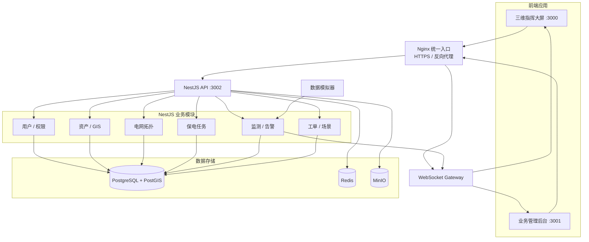
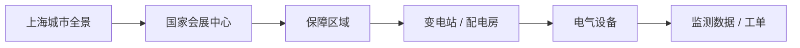
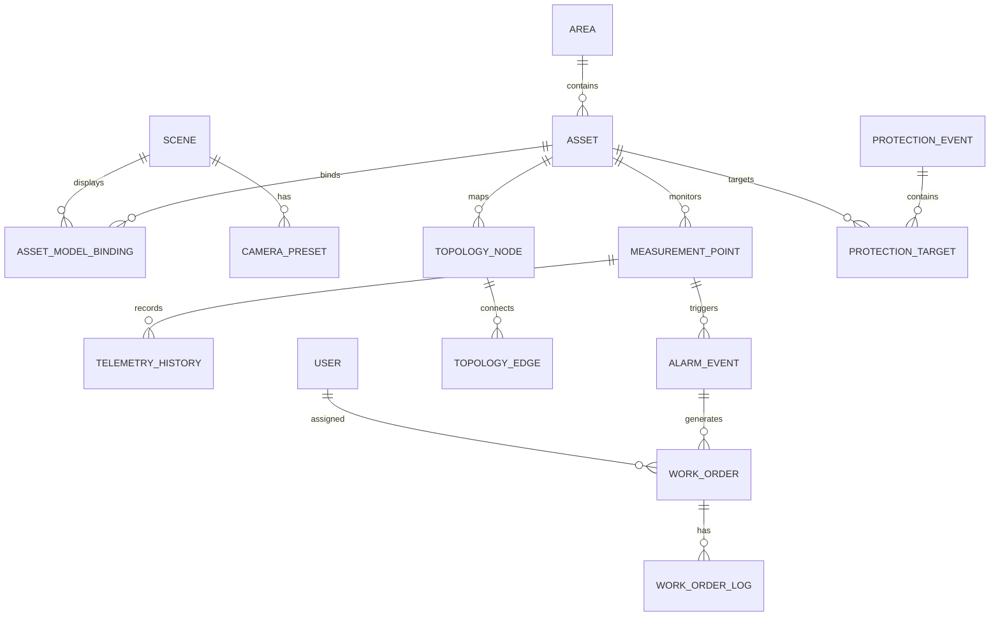
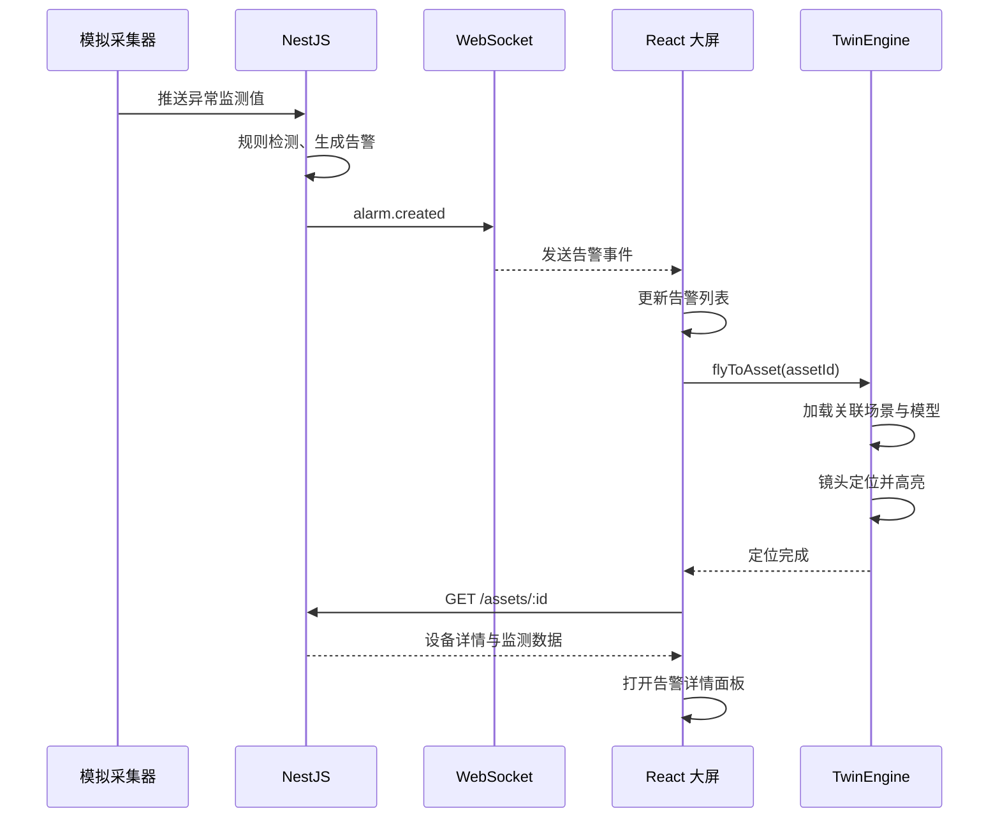
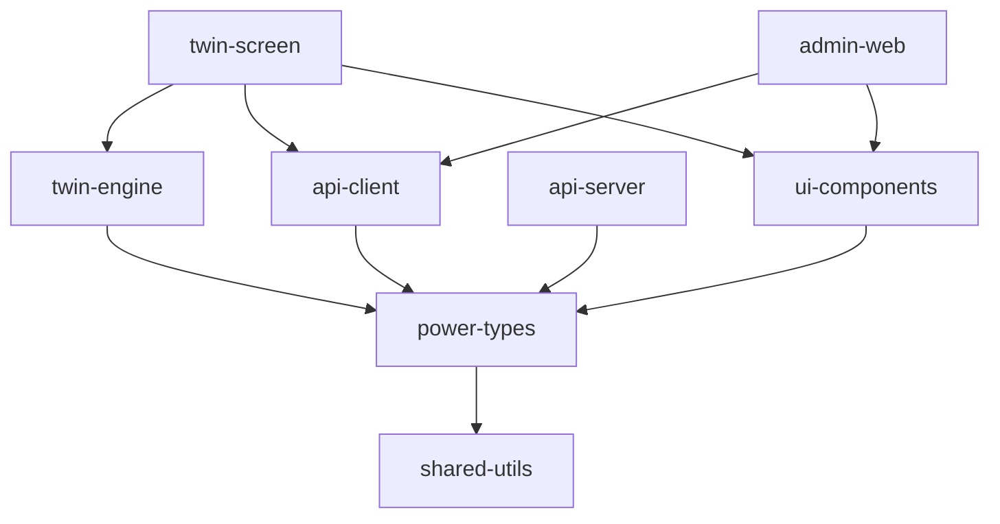

# 上海进博会全景智慧电力保障系统
<text color="secondary">方案 B · 可运营 MVP · 系统架构设计 V1.0 · 2026-11-04</text>

## 一、项目建设范围与总体技术架构

### 1.1 项目目标

以视频中的上海进博会保电场景为视觉参考，建设一套能够实际管理电力资产、展示供电网络、监测模拟运行数据、处理告警工单的 Web 数字孪生系统。

本期的核心验收流程是：

**保电任务配置 → 三维场景加载 → 运行状态监测 → 异常告警 → 故障定位 → 工单处理 → 恢复确认 → 事件归档。**

与纯视觉 Demo 的区别在于：所有关键设备、线路、监测数据和业务状态都来自统一后端，而不是硬编码在 Three.js 场景中。

### 1.2 系统边界

<box border radius="xl" padding={3} gap={3}>
  <grid columns={3} gap={2}>
    <grid-item>
      <box background="rgba(40,117,190,0.08)" border={{size:1,color:"rgba(40,117,190,0.3)"}} radius="lg" padding={3} gap={1} align="center" minHeight="116px">
        <icon name="globe-2" size="lg"/>
        **系统 A**
        <text weight="medium" size="xs" textAlign="center">三维指挥大屏</text>
        <text color="secondary" size="2xs">React + Cesium</text>
      </box>
    </grid-item>
    <grid-item>
      <box background="rgba(40,117,190,0.08)" border={{size:1,color:"rgba(40,117,190,0.3)"}} radius="lg" padding={3} gap={1} align="center" minHeight="116px">
        <icon name="layout-dashboard" size="lg"/>
        **系统 B**
        <text weight="medium" size="xs" textAlign="center">综合业务后台</text>
        <text color="secondary" size="2xs">React + Ant Design</text>
      </box>
    </grid-item>
    <grid-item>
      <box background="rgba(55,145,110,0.08)" border={{size:1,color:"rgba(55,145,110,0.3)"}} radius="lg" padding={3} gap={1} align="center" minHeight="116px">
        <icon name="server" size="lg"/>
        **系统 C**
        <text weight="medium" size="xs" textAlign="center">统一业务后端</text>
        <text color="secondary" size="2xs">NestJS + PostgreSQL</text>
      </box>
    </grid-item>
  </grid>
  <text size="xs" color="secondary" textAlign="center">2 个独立前端应用 + 1 个模块化后端。场景编辑器和移动端暂不建设。</text>
</box>

### 1.3 推荐技术栈

| 层级 | 选型 | 选择原因 |
|---|---|---|
| 前端框架 | React + TypeScript + Vite | 统一两个前端应用 |
| UI 框架 | Ant Design 6 / ECharts | 后台管理与统计分析 |
| 城市三维 | CesiumJS | GIS、三维建筑、镜头导航、空间拾取 |
| 精细模型 | glTF / GLB | 会展中心、变电站及设备 |
| 精细动画 | Cesium 优先，必要时 Three.js | 设备动画与专用效果 |
| 前端状态 | Zustand + TanStack Query | 场景状态与服务端数据分离 |
| 后端框架 | NestJS + TypeScript | 模块化、鉴权、WebSocket、OpenAPI |
| ORM | Prisma + 专用空间 SQL | 常规业务 CRUD 与 PostGIS 查询 |
| 关系数据库 | PostgreSQL + PostGIS | 资产、业务和空间数据 |
| 时序数据 | PostgreSQL 分区表 | 首期遥测历史，后续可扩展 TimescaleDB |
| 缓存 | Redis | 最新测点、会话、事件分发 |
| 对象存储 | MinIO | 模型、图片、附件及导入文件 |
| 实时通信 | WebSocket | 监测状态、告警、工单消息 |
| 工程管理 | pnpm Workspace + Turborepo | 多应用共享代码和构建缓存 |
| 部署 | Docker Compose + Nginx | 开发、测试及中小规模部署 |

CesiumJS 原生支持 3D Tiles、模型拾取及镜头导航，适合作为城市级场景主引擎。<Cite refs={["turn801970search2","turn801970search6"]}/> NestJS 的模块和 WebSocket Gateway 能覆盖 MVP 的主要后端需求。<Cite ref="turn801970search0"/>

### 1.4 运行架构



采用模块化单体时，这些业务模块运行在同一个 NestJS 服务进程中，不需要额外部署六套后端。

---

## 二、系统 A：三维数字孪生指挥大屏

### 2.1 页面路由清单

| 页面 ID | 路由 | 页面名称 | 级别 |
|---|---|---|---|
| A01 | `/twin/overview` | 上海城市电网全景 | P0 |
| A02 | `/twin/protection/:eventId` | 进博会重点保电专题 | P0 |
| A03 | `/twin/area/:areaId` | 保电区域三维场景 | P0 |
| A04 | `/twin/station/:stationId` | 变电站 / 配电房详情 | P0 |
| A05 | `/twin/device/:assetId` | 电力设备三维详情 | P0 |
| A06 | `/twin/topology` | 电网拓扑可视化 | P0 |
| A07 | `/twin/alarms` | 告警态势与定位 | P0 |
| A08 | `/twin/replay` | 保电演示 / 事件回放 | P1 |

这里的不同路由不代表要为每一页创建独立 Cesium 实例。建议通过一个持久化的三维 Viewer，在路由变化时切换场景图层、业务数据及镜头状态。

### 2.2 核心页面 A01：城市电网全景

<AsyncImage query="Shanghai city 3D power grid digital twin control center dashboard dark blue electric power lines visualization" aspectRatio="16:9"/>

这是项目的总入口，构图参考原视频的深色科技大屏。

<box border radius="xl" padding={2} gap={2}>
  <box background="#142b45" padding={3} radius="md" theme="dark" align="center" gap={1}>
    <text color="#ffffff" weight="semibold">上海进博会全景智慧供电保障系统</text>
    <text color="#9ebad3" size="2xs">系统时间 · 保电任务 · 场景导航 · 用户状态</text>
  </box>
  <grid columns={12} gap={2}>
    <grid-item span={3}>
      <box background="surface-secondary" padding={2} radius="md" gap={2} minHeight="194px">
        <text size="xs" weight="medium">左侧运行态势</text>
        <divider color="subtle"/>
        <text size="2xs">电网资产统计</text>
        <box background="surface-tertiary" height="23px" radius="sm"/>
        <text size="2xs">电力负荷趋势</text>
        <box background="surface-tertiary" height="45px" radius="sm"/>
        <text size="2xs">保障对象分类</text>
        <box background="surface-tertiary" height="36px" radius="sm"/>
      </box>
    </grid-item>
    <grid-item span={6}>
      <box background="#10243a" theme="dark" minHeight="194px" radius="md" justify="center" align="center" gap={2}>
        <icon name="map" color="#69b5ff" size="3xl"/>
        <text color="#ffffff" weight="medium" size="sm">Cesium 城市三维主场景</text>
        <text size="2xs" color="#adc3d9">建筑 · 变电站 · 电网线路 · POI</text>
        <row gap={1}>
          {#each ["城市","保电区","线路"] as item}
            <box border={{size:1,color:"#466783"}} radius="sm" padding={{x:2,y:1}}>
              <text color="#c2dcef" size="2xs">{item}</text>
            </box>
          {/each}
        </row>
      </box>
    </grid-item>
    <grid-item span={3}>
      <box background="surface-secondary" padding={2} radius="md" gap={2} minHeight="194px">
        <text size="xs" weight="medium">右侧保障信息</text>
        <divider color="subtle"/>
        <text size="2xs">保障任务概况</text>
        <box background="surface-tertiary" height="30px" radius="sm"/>
        <text size="2xs">设备运行状态</text>
        <box background="surface-tertiary" height="37px" radius="sm"/>
        <text size="2xs">实时告警列表</text>
        <box background="surface-tertiary" height="37px" radius="sm"/>
      </box>
    </grid-item>
  </grid>
  <box background="surface-secondary" radius="md" padding={2} align="center">
    <text size="xs">底部导航：全景态势 / 重点保电 / 电网拓扑 / 设备监控 / 告警指挥</text>
  </box>
  <caption>1920×1080 目标界面的布局示意，实际开发采用 CSS Grid + 三维 Canvas 绝对定位。</caption>
</box>

A01 核心功能：

| 功能 | 用户操作 | 系统反馈 |
|---|---|---|
| 城市漫游 | 拖拽、缩放、旋转 | 镜头实时更新 |
| 变电站筛选 | 选择电压等级、运行状态 | 过滤资产标记 |
| 供电线路展示 | 打开线路图层 | 显示线路及流光 |
| 重点保电区域 | 点击国家会展中心 | 飞入 A02 保电专题 |
| 设备信息查看 | 点击空间标记 | 弹出设备卡片 |
| 告警定位 | 点击右侧告警 | 镜头定位、高亮对象 |
| 自动巡航 | 点击巡航按钮 | 按预设镜头路径播放 |

### 2.3 核心页面 A02：进博会保电专题

这一页应该成为首期的**视觉标杆页面**。

<AsyncImage query="National Exhibition and Convention Center Shanghai aerial view four leaf clover building 3d" aspectRatio="16:9"/>

场景中主要展示国家会展中心及周边供电设施。

| 对象 | 三维表达 | 交互 |
|---|---|---|
| 国家会展中心 | 精细建筑 GLB 模型 | 点击聚焦、建筑高亮 |
| 周边城市建筑 | 3D Tiles / 简模 | LOD 自动加载 |
| 保障范围 | 半透明区域面、描边光效 | 显示保障对象 |
| 变电站 | 三维模型、空间标签 | 跳转站所详情 |
| 电缆线路 | 动态发光曲线 | 点击查看线路信息 |
| 重点用户 | POI 图标、状态颜色 | 查看供电路径 |
| 告警设备 | 脉冲圈、红色标记 | 进入故障定位 |
| 应急资源 | 车辆 / 人员位置标记 | 查看资源信息 |

建议将镜头动画配置成数据：

```ts
type CameraPreset = {
  id: string;
  sceneId: string;
  name: string;
  destination: {
    lng: number;
    lat: number;
    height: number;
  };
  orientation: {
    heading: number;
    pitch: number;
    roll: number;
  };
  duration: number;
  easing?: "linear" | "easeInOut";
};
```

### 2.4 场景下钻交互



必须同时支持两种导航方式：用户在三维模型中点击进入，以及从面包屑中返回上级场景。

建议保存每一级的相机状态、选中资产和图层状态。返回上一层时恢复原镜头，而不是重置到默认视角。

---

## 三、系统 B：综合业务管理后台

### 3.1 完整菜单树

<box border radius="xl" padding={3} gap={2}>
  {@body const menus=[{n:"工作台",d:"首页统计、待办任务、告警概况、快捷入口",p:"/dashboard"},{n:"电力资产管理",d:"区域管理、变电站、配电房、设备台账、线路台账、模型绑定",p:"/assets"},{n:"供电拓扑管理",d:"拓扑节点、连接关系、线路路径、拓扑版本、影响分析",p:"/topology"},{n:"实时运行监测",d:"监测点配置、实时状态、历史曲线、阈值规则",p:"/monitoring"},{n:"重点保电管理",d:"保电活动、重点区域、保障对象、供电路径、保障计划",p:"/protection"},{n:"告警处置中心",d:"实时告警、历史告警、规则配置、告警确认",p:"/alarms"},{n:"运维工单管理",d:"工单列表、任务分配、处理记录、完成复核",p:"/work-orders"},{n:"三维场景管理",d:"场景列表、模型资源、设备绑定、POI 配置、镜头预设",p:"/scenes"},{n:"数据分析报表",d:"资产统计、运行状态、告警统计、保电事件报告",p:"/reports"},{n:"系统管理",d:"用户、角色、权限、字典、审计日志",p:"/system"}]}
  {@body const [expanded,setExpanded]=DIL.useState([0,1,4,5])}
  {#each menus as m,i}
    <box key={i} gap={1}>
      <pressable onClick={()=>setExpanded(old=>old.includes(i)?old.filter(v=>v!==i):[...old,i])} direction="row" align="center" justify="between" padding={{y:1}}>
        <row align="center" gap={2}>
          <icon name={expanded.includes(i)?"folder-open":"folder"} color="secondary"/>
          <text weight="medium" size="sm">{m.n}</text>
        </row>
        <icon name={expanded.includes(i)?"chevron-up":"chevron-down"} color="tertiary" size="sm"/>
      </pressable>
      {#if expanded.includes(i)}
        <box background="surface-secondary" radius="md" padding={2} gap={1}>
          <text size="xs">{m.d}</text>
          <text size="2xs" color="tertiary">{m.p}</text>
        </box>
      {/if}
      {#if i<menus.length-1}
        <divider color="subtle"/>
      {/if}
    </box>
  {/each}
</box>

### 3.2 具体页面清单

| 模块 | 页面 / 路由 | 核心操作 | 优先级 |
|---|---|---|---|
| 工作台 | `/dashboard` | 统计、待办、告警 | P0 |
| 资产 | `/assets/areas` | 区域增删改查 | P0 |
| 资产 | `/assets/stations` | 变电站管理 | P0 |
| 资产 | `/assets/equipment` | 设备台账 | P0 |
| 资产 | `/assets/lines` | 供电线路管理 | P0 |
| 资产 | `/assets/import` | CSV / Excel 批量导入 | P1 |
| 拓扑 | `/topology/graph` | 拓扑关系查看与编辑 | P0 |
| 拓扑 | `/topology/paths` | 供电路径查询 | P0 |
| 监测 | `/monitoring/points` | 测点配置 | P0 |
| 监测 | `/monitoring/realtime` | 最新值与状态查看 | P0 |
| 监测 | `/monitoring/history` | 历史曲线 | P0 |
| 保电 | `/protection/events` | 保电任务 CRUD | P0 |
| 保电 | `/protection/events/:id` | 保障对象与线路关联 | P0 |
| 告警 | `/alarms/events` | 告警确认、定位 | P0 |
| 告警 | `/alarms/rules` | 告警阈值维护 | P0 |
| 工单 | `/work-orders` | 创建、分配、处理、关闭 | P0 |
| 场景 | `/scenes` | 场景列表、发布 | P0 |
| 场景 | `/scenes/models` | 模型上传、绑定 | P0 |
| 场景 | `/scenes/cameras` | 镜头预设维护 | P1 |
| 报表 | `/reports/protection` | 保电活动报告 | P1 |
| 系统 | `/system/users` | 用户管理 | P0 |
| 系统 | `/system/roles` | 角色及权限 | P0 |
| 系统 | `/system/audit` | 操作审计 | P0 |

**后台首期约 23 个路由页面。** 其中详情、编辑、确认等操作优先采用 Drawer / Modal，避免每个操作都增加独立页面。

### 3.3 角色与权限

| 角色 | 主要权限 |
|---|---|
| 超级管理员 | 系统配置、角色管理、全部资源 |
| 保电管理员 | 保电活动、保障对象、计划配置 |
| 运维主管 | 资产查看、告警管理、工单分配 |
| 运维人员 | 查看分配的工单、提交处理记录 |
| 指挥大屏用户 | 三维查看、告警查看，无设备控制权限 |

权限结构采用 RBAC，功能权限与数据范围分离。所有后端资源访问都需要重新校验权限，不能仅依靠前端隐藏菜单。

---

## 四、数据库设计

### 4.1 数据库总体方案

首期采用一个 PostgreSQL 实例，按业务逻辑划分表，不使用跨数据库分布式事务。

空间数据使用 PostGIS 的 `geometry` 类型，电力拓扑使用关系表表达，运行历史使用按时间分区的时序表。

PostGIS 空间字段建议建立 GiST 索引，并通过 `ST_Intersects`、`ST_DWithin` 等函数执行空间检索。<Cite ref="turn801970search7"/>

### 4.2 ER 核心关系



一个资产可以包含多个监测点；一个监测点拥有多条历史记录；告警可以关联设备和监测点；工单通过告警事件关联三维资产。

需要特别区分 `asset` 和 `topology_node`：资产是业务台账对象，而拓扑节点可能是母线端点、接线端子或逻辑连接点，不一定对应一个独立实物资产。

### 4.3 数据表清单

<text color="secondary" size="xs">以下为核心表设计。所有主数据表统一包含 `id`、`created_at`、`updated_at`；需要追踪责任人的表增加 `created_by`、`updated_by`。</text>

| 业务域 | 表名 | 主要字段 |
|---|---|---|
| 组织权限 | `sys_user` | username, password_hash, status |
| 组织权限 | `sys_role` | code, name, status |
| 组织权限 | `sys_user_role` | user_id, role_id |
| 组织权限 | `sys_permission` | code, resource, action |
| 组织权限 | `sys_role_permission` | role_id, permission_id |
| 组织权限 | `sys_audit_log` | actor_id, action, resource_id, diff, occurred_at |
| 资产 | `area` | name, type, parent_id, boundary |
| 资产 | `asset` | code, name, type, area_id, parent_id, location, status |
| 资产 | `power_line` | asset_id, voltage_level, route, length_m |
| 拓扑 | `topology_node` | asset_id, node_type, electrical_code |
| 拓扑 | `topology_edge` | from_node_id, to_node_id, line_id, state |
| 拓扑 | `topology_version` | version, status, published_at |
| 拓扑 | `topology_edge_version` | version_id, edge_id, snapshot |
| 监测 | `measurement_point` | asset_id, code, metric, unit |
| 监测 | `telemetry_history` | point_id, ts, value, quality |
| 监测 | `alarm_rule` | point_id, operator, threshold, severity |
| 告警 | `alarm_event` | rule_id, point_id, asset_id, severity, status |
| 保电 | `protection_event` | name, start_time, end_time, status |
| 保电 | `protection_target` | event_id, asset_id, priority |
| 保电 | `protection_plan` | event_id, name, content, status |
| 运维 | `work_order` | alarm_id, assignee_id, status, priority |
| 运维 | `work_order_log` | order_id, operator_id, action, remark |
| 场景 | `scene` | code, name, level, config, status |
| 场景 | `scene_layer` | scene_id, type, config, visible |
| 场景 | `scene_model` | name, file_key, format, version |
| 场景 | `asset_model_binding` | scene_id, asset_id, model_id, transform |
| 场景 | `camera_preset` | scene_id, name, destination, orientation |

首期共 **27 张核心业务表**。数据字典、文件上传记录、工单附件、历史状态等辅助表可在详细设计时增加。

### 4.4 核心资产表 SQL

<CodeBlock language="sql" editable>
CREATE EXTENSION IF NOT EXISTS postgis;

CREATE TABLE area (
  id UUID PRIMARY KEY,
  parent_id UUID REFERENCES area(id),
  code VARCHAR(64) NOT NULL UNIQUE,
  name VARCHAR(128) NOT NULL,
  type VARCHAR(32) NOT NULL,
  boundary GEOMETRY(MultiPolygon, 4326),
  created_at TIMESTAMPTZ NOT NULL DEFAULT now(),
  updated_at TIMESTAMPTZ NOT NULL DEFAULT now()
);

CREATE TABLE asset (
  id UUID PRIMARY KEY,
  code VARCHAR(64) NOT NULL UNIQUE,
  name VARCHAR(128) NOT NULL,
  type VARCHAR(32) NOT NULL,
  area_id UUID REFERENCES area(id),
  parent_id UUID REFERENCES asset(id),
  voltage_level VARCHAR(32),
  status VARCHAR(24) NOT NULL DEFAULT 'NORMAL',
  location GEOMETRY(Point, 4326),
  properties JSONB NOT NULL DEFAULT '{}'::jsonb,
  created_at TIMESTAMPTZ NOT NULL DEFAULT now(),
  updated_at TIMESTAMPTZ NOT NULL DEFAULT now()
);

CREATE INDEX idx_asset_area ON asset(area_id);
CREATE INDEX idx_asset_parent ON asset(parent_id);
CREATE INDEX idx_asset_location
  ON asset USING GIST(location);
</CodeBlock>

`properties` 用于保存型号、厂家等设备类型特有的扩展属性。设备编码、状态、位置和关联关系等查询频繁的字段必须使用独立列。

### 4.5 电网拓扑 SQL

<CodeBlock language="sql" editable>
CREATE TABLE topology_node (
  id UUID PRIMARY KEY,
  asset_id UUID REFERENCES asset(id),
  electrical_code VARCHAR(64) NOT NULL UNIQUE,
  node_type VARCHAR(32) NOT NULL,
  created_at TIMESTAMPTZ NOT NULL DEFAULT now()
);

CREATE TABLE topology_edge (
  id UUID PRIMARY KEY,
  from_node_id UUID NOT NULL
    REFERENCES topology_node(id),
  to_node_id UUID NOT NULL
    REFERENCES topology_node(id),
  line_id UUID REFERENCES asset(id),
  state VARCHAR(16) NOT NULL
    CHECK (state IN ('CLOSED', 'OPEN', 'UNKNOWN')),
  created_at TIMESTAMPTZ NOT NULL DEFAULT now(),
  CHECK (from_node_id <> to_node_id)
);

CREATE INDEX idx_edge_from
  ON topology_edge(from_node_id);

CREATE INDEX idx_edge_to
  ON topology_edge(to_node_id);
</CodeBlock>

供电拓扑不是普通的树结构，可能存在环网和多电源连接。遍历时必须维护 visited 集合，并根据开关状态决定当前连通关系。

正式生产场景还需要增加拓扑版本、连接端子、电气设备类型和遥信状态的有效时间；MVP 先完成只读路径追踪与影响分析。

### 4.6 监测数据 SQL

<CodeBlock language="sql" editable>
CREATE TABLE measurement_point (
  id UUID PRIMARY KEY,
  asset_id UUID NOT NULL REFERENCES asset(id),
  code VARCHAR(64) NOT NULL UNIQUE,
  metric VARCHAR(48) NOT NULL,
  unit VARCHAR(16) NOT NULL,
  enabled BOOLEAN NOT NULL DEFAULT true
);

CREATE TABLE telemetry_history (
  point_id UUID NOT NULL REFERENCES measurement_point(id),
  ts TIMESTAMPTZ NOT NULL,
  value DOUBLE PRECISION NOT NULL,
  quality VARCHAR(16) NOT NULL DEFAULT 'GOOD',
  PRIMARY KEY (point_id, ts)
) PARTITION BY RANGE (ts);

CREATE TABLE telemetry_history_2026_11
PARTITION OF telemetry_history
FOR VALUES FROM ('2026-11-01')
TO ('2026-12-01');
</CodeBlock>

这个表是历史遥测数据的基础结构。真实项目还要根据保留周期自动创建新分区、清理旧分区，并支持一个测点在同一时间出现多条采集记录的场景（可增加采集序号）。

实时最新值单独存放 Redis，例如：

```text
telemetry:latest:{pointId}

{
  value: 10.53,
  unit: "kV",
  quality: "GOOD",
  timestamp: "2026-11-04T08:00:00Z"
}
```

客户端按资产订阅测点，而不是直接订阅整座城市所有监测点。

### 4.7 告警及工单状态机

<grid columns={2} gap={3}>
  <grid-item>
    **告警状态**

    ```mermaid
    flowchart TD
      A["ACTIVE"] --> B["ACKNOWLEDGED"]
      A --> C["CLEARED"]
      B --> C
      C --> D["CLOSED"]
    ```
  </grid-item>
  <grid-item>
    **工单状态**

    ```mermaid
    flowchart TD
      A["NEW"] --> B["ASSIGNED"]
      B --> C["IN_PROGRESS"]
      C --> D["PENDING_REVIEW"]
      D --> E["CLOSED"]
      D --> C
    ```
  </grid-item>
</grid>

告警消除不等于工单已经处理完成。告警状态表示设备异常是否仍存在，工单状态表示人员处置流程是否完成，二者必须独立管理。

---

## 五、REST API 接口设计

统一前缀：

`/api/v1`

统一认证方式：短期 Access Token + 安全的 Refresh Token 机制；刷新令牌放在 HttpOnly、Secure Cookie 中。

### 5.1 用户与系统

| Method | Endpoint | 用途 |
|---|---|---|
| POST | `/auth/login` | 登录 |
| POST | `/auth/refresh` | 刷新令牌 |
| POST | `/auth/logout` | 退出 |
| GET | `/auth/me` | 当前用户和权限 |
| GET / POST | `/users` | 查询 / 创建用户 |
| PATCH | `/users/:id` | 修改用户 |
| GET / POST | `/roles` | 角色查询 / 创建 |
| PUT | `/roles/:id/permissions` | 设置角色权限 |
| GET | `/audit-logs` | 查询审计记录 |

### 5.2 资产与电网

| Method | Endpoint | 用途 |
|---|---|---|
| GET / POST | `/areas` | 区域列表 / 新建 |
| GET / PATCH | `/areas/:id` | 区域详情 / 编辑 |
| GET / POST | `/assets` | 资产列表 / 新建 |
| GET / PATCH | `/assets/:id` | 资产详情 / 编辑 |
| GET | `/assets/:id/children` | 子资产 |
| GET | `/assets/:id/measurements` | 关联测点 |
| GET | `/assets/geojson` | 按视域查询资产坐标 |
| GET / POST | `/power-lines` | 电力线路管理 |
| GET | `/topology/graph` | 拓扑图节点和边 |
| GET | `/topology/paths` | 两个节点间供电路径 |
| GET | `/topology/impact` | 基于拓扑版本的影响分析 |

`/assets/geojson` 必须支持 `bbox`、`zoom`、`type` 等筛选条件。城市级场景不应一次加载所有资产。

### 5.3 实时监测与告警

| Method | Endpoint | 用途 |
|---|---|---|
| GET / POST | `/measurement-points` | 监测点配置 |
| GET | `/telemetry/latest` | 批量查询最新值 |
| GET | `/telemetry/history` | 历史时序 |
| GET / POST | `/alarm-rules` | 阈值规则维护 |
| GET | `/alarms` | 告警分页列表 |
| GET | `/alarms/:id` | 告警详情 |
| POST | `/alarms/:id/acknowledge` | 确认告警 |
| POST | `/alarms/:id/close` | 关闭已满足条件的告警 |
| GET | `/statistics/overview` | 大屏总览统计 |

### 5.4 保电业务与工单

| Method | Endpoint | 用途 |
|---|---|---|
| GET / POST | `/protection-events` | 保电活动管理 |
| GET / PATCH | `/protection-events/:id` | 活动详情 / 修改 |
| PUT | `/protection-events/:id/targets` | 绑定保电对象 |
| GET | `/protection-events/:id/assets` | 关联资产 |
| GET / POST | `/protection-plans` | 保障预案 |
| GET / POST | `/work-orders` | 工单列表 / 创建 |
| GET | `/work-orders/:id` | 工单详情 |
| POST | `/work-orders/:id/assign` | 指派 |
| POST | `/work-orders/:id/start` | 开始处理 |
| POST | `/work-orders/:id/submit` | 提交复核 |
| POST | `/work-orders/:id/review` | 审核通过 / 驳回 |

涉及状态流转的接口必须校验当前状态、操作者权限和版本号。重复提交需要幂等处理，避免生成重复工单或重复记录。

### 5.5 三维场景接口

| Method | Endpoint | 用途 |
|---|---|---|
| GET / POST | `/scenes` | 场景列表 / 创建 |
| GET | `/scenes/:id` | 获取场景配置 |
| GET | `/scenes/:id/layers` | 图层列表 |
| GET | `/scenes/:id/objects` | 场景对象 |
| GET | `/scenes/:id/cameras` | 镜头预设 |
| GET / POST | `/scene-models` | 模型资源 |
| POST | `/scene-models/upload-url` | 获取授权上传地址 |
| PUT | `/scenes/:id/bindings` | 批量配置模型和资产绑定 |
| POST | `/scenes/:id/publish` | 发布场景版本 |

上传模型使用服务端校验后的预签名上传机制，不允许客户端随意传入任意存储路径。首期场景配置以表单与 JSON 为主，不开发完整拖拽式编辑器。

### 5.6 统一返回格式

<CodeBlock language="json" editable>
{
  "code": "OK",
  "message": "success",
  "data": {
    "id": "asset-10001",
    "name": "1号主变压器",
    "status": "NORMAL"
  },
  "requestId": "req-abc123"
}
</CodeBlock>

列表接口统一返回 `items`、`total`、`page`、`pageSize`。失败响应使用正确的 HTTP 状态码和稳定的业务错误码。

NestJS 可通过 `@nestjs/swagger` 生成 OpenAPI 文档，并据此生成前端 TypeScript API Client。<Cite ref="turn801970search3"/>

---

## 六、WebSocket 实时通信设计

首期仅有一个 WebSocket 网关。生产演进时可以独立拆分。

### 6.1 消息通道

| 事件 | 方向 | 说明 |
|---|---|---|
| `telemetry.subscribe` | 客户端 → 服务端 | 订阅测点 |
| `telemetry.batch` | 服务端 → 客户端 | 批量推送最新值 |
| `alarm.created` | 服务端 → 客户端 | 新告警 |
| `alarm.updated` | 服务端 → 客户端 | 告警状态变化 |
| `asset.status_changed` | 服务端 → 客户端 | 设备状态更新 |
| `work_order.updated` | 服务端 → 客户端 | 工单变化 |
| `system.heartbeat` | 双向 | 心跳与连接检测 |

### 6.2 遥测数据报文

<CodeBlock language="json" editable>
{
  "event": "telemetry.batch",
  "seq": 10245,
  "timestamp": "2026-11-04T08:00:00Z",
  "data": [
    {
      "assetId": "asset-10001",
      "pointId": "mp-voltage-a",
      "metric": "voltage",
      "value": 10.53,
      "unit": "kV",
      "quality": "GOOD"
    },
    {
      "assetId": "asset-10001",
      "pointId": "mp-temperature",
      "metric": "temperature",
      "value": 43.6,
      "unit": "°C",
      "quality": "GOOD"
    }
  ]
}
</CodeBlock>

浏览器端需要实现自动重连、订阅恢复、数据过期检测、序列号去重，以及断线后通过 HTTP 重新拉取最新快照。

建议模拟数据每 1–5 秒生成一次，服务端批量推送。三维标签不需要跟着每条采样立即重建 DOM 或模型，应该做节流与差量更新。

---

## 七、三维引擎详细设计

这一部分直接决定未来能不能从「上海进博会项目」扩展成通用数字孪生平台。

### 7.1 三维引擎分层

<box border radius="xl" padding={3} gap={2}>
  <box background="surface-secondary" radius="md" padding={3} gap={1} align="center">
    **React 业务组件层**

    <text size="xs" color="secondary" textAlign="center">业务面板 · 告警卡片 · 设备详情 · 底部导航</text>
  </box>
  <row justify="center"><icon name="arrow-down" color="tertiary"/></row>
  <box border={{size:1,color:"rgba(48,133,197,0.4)"}} radius="md" padding={3} gap={2}>
    <text weight="medium" textAlign="center">Twin Application SDK</text>
    <grid columns={3} gap={2}>
      {#each ["SceneRouter","SelectionManager","DataBinding","EventController","TourController","LayerController"] as item}
        <grid-item>
          <box background="rgba(48,133,197,0.08)" radius="sm" padding={2} align="center">
            <text size="2xs" weight="medium" textAlign="center">{item}</text>
          </box>
        </grid-item>
      {/each}
    </grid>
  </box>
  <row justify="center"><icon name="arrow-down" color="tertiary"/></row>
  <box border radius="md" padding={3} gap={2}>
    <text weight="medium" textAlign="center">渲染与交互内核</text>
    <grid columns={3} gap={2}>
      {#each ["Camera","Tileset","Model","PowerLine","POI / Label","Effects"] as item}
        <grid-item>
          <box background="surface-secondary" radius="sm" padding={2} align="center">
            <text size="2xs" textAlign="center">{item}</text>
          </box>
        </grid-item>
      {/each}
    </grid>
  </box>
  <row justify="center"><icon name="arrow-down" color="tertiary"/></row>
  <box background="surface-secondary" radius="md" padding={3} align="center" gap={1}>
    **CesiumJS 渲染引擎**

    <text size="xs" color="secondary">WebGL · 3D Tiles · glTF · Entity · Primitive</text>
  </box>
</box>

### 7.2 核心模块职责

| 模块 | 主要职责 | 关键 API |
|---|---|---|
| `TwinEngine` | 初始化、销毁、全局配置 | `init`, `dispose` |
| `SceneManager` | 场景加载、卸载、切换 | `loadScene`, `switchScene` |
| `CameraManager` | 飞行、聚焦、镜头恢复 | `flyTo`, `focusAsset`, `restore` |
| `TilesetManager` | 城市模型和 3D Tiles 管理 | `load`, `unload` |
| `ModelManager` | GLB 设备模型和实例 | `addModel`, `removeModel` |
| `PowerLineLayer` | 电力线、颜色、流光 | `setLines`, `highlightPath` |
| `LabelManager` | 空间标签、聚合、遮挡 | `addPOI`, `setVisible` |
| `SelectionManager` | 射线拾取、选中高亮 | `pick`, `select`, `clear` |
| `EffectManager` | 发光、脉冲、告警效果 | `play`, `stop` |
| `DataBindingManager` | 设备状态与模型同步 | `bind`, `update` |
| `TourManager` | 自动巡航、关键帧播放 | `play`, `pause`, `seek` |

### 7.3 引擎统一接口

<CodeBlock language="typescript" editable>
export interface ITwinEngine {
  init(container: HTMLElement): Promise<void>;

  loadScene(sceneId: string): Promise<void>;

  flyToAsset(assetId: string): Promise<void>;

  selectAsset(assetId: string): void;

  setLayerVisible(
    layerId: string,
    visible: boolean
  ): void;

  highlightPowerPath(
    pathId: string,
    color?: string
  ): void;

  updateAssetState(
    assetId: string,
    state: AssetRenderState
  ): void;

  playTour(tourId: string): Promise<void>;

  dispose(): void;
}

export type AssetRenderState = {
  status: "NORMAL" | "WARNING" | "FAULT" | "OFFLINE";
  metrics?: Record<string, number>;
};
</CodeBlock>

这样 React 业务层可以通过 `twinEngine.flyToAsset(assetId)` 定位设备，而不需要直接操作 Cesium Entity。

### 7.4 三维对象与业务资产绑定

推荐数据结构：

<CodeBlock language="json" editable>
{
  "sceneId": "scene-expo",
  "assetId": "asset-transformer-001",
  "objectId": "model-transformer-001",
  "modelId": "glb-transformer-a",
  "transform": {
    "position": {
      "lng": 121.301,
      "lat": 31.192,
      "height": 5.2
    },
    "rotation": [0, 0, 0],
    "scale": [1, 1, 1]
  },
  "interaction": {
    "selectable": true,
    "highlight": true,
    "openDetail": true
  }
}
</CodeBlock>

上面坐标仅为数据格式示例，并非已校准的真实设备位置。

模型资源与业务资产通过 ID 绑定。点击模型时，拾取结果应能还原 `assetId`，然后查询后端资产详情。对合批模型、3D Tiles Feature 或多个部件组成的设备，需要建立对象映射表，不能依赖显示名称匹配。

### 7.5 核心交互：告警自动定位



定位时特别注意：告警的 `assetId` 可能属于配电房内部设备，而当前场景是上海城市。引擎需要先解析资产所属场景链，再决定应该加载哪个场景。

### 7.6 线路动画设计

电力线路建议同时维护三个概念：

| 数据 | 含义 | 可视化 |
|---|---|---|
| 地理路径 `route` | 线路实际空间位置 | Cesium Polyline |
| 拓扑边 `topology_edge` | 电气连接关系 | 供电路径分析 |
| 运行状态 `state` | 正常、异常、停运等 | 颜色、动画状态 |

三者不能混用。一条拓扑边可能对应多段实际地理线路，线路几何位置也不代表当前电气连通状态。

动画第一版可使用 Cesium Material / Primitive 实现动态纹理流动。电压等级用颜色及图例区分，流光只能表达演示或经过计算的方向，不能默认认为流光方向就是真实潮流方向。

### 7.7 模型与渲染性能

<text color="secondary" size="xs">以下是项目设计目标，实际值需在目标硬件上压测，不是 Cesium 的性能保证。</text>

| 指标 | MVP 目标 |
|---|---|
| 设计分辨率 | 1920×1080 |
| 场景稳定帧率 | 常用演示工作站 ≥30 FPS |
| 目标帧率 | 60 FPS，允许按设备降级 |
| 首屏可操作时间 | 本地缓存 / 局域网环境约 5 秒以内 |
| 典型场景切换 | 已缓存场景约 3 秒以内 |
| POI 数量 | 典型视图 200 个以内，超出聚合 |
| 线路数量 | 首期 100–300 条示例线路 |
| 设备数量 | 500–1000 个模拟资产 |
| WebSocket 延迟 | 测试环境 P95 小于 1 秒 |
| 内存 | 长时间巡航无持续增长趋势 |

优化重点是按需加载、LOD、资源释放、批量渲染、标签聚合、动画限帧以及数据更新与渲染解耦。Cesium 3D Tiles 本身提供屏幕空间误差和缓存等调节选项。<Cite ref="turn801970search6"/>

---

## 八、Monorepo 工程架构

### 8.1 完整项目目录

<CodeBlock language="text">
smart-power/
├── apps/
│   ├── twin-screen/
│   │   ├── src/
│   │   │   ├── app/
│   │   │   ├── pages/
│   │   │   │   ├── overview/
│   │   │   │   ├── protection/
│   │   │   │   ├── station/
│   │   │   │   ├── device/
│   │   │   │   └── alarms/
│   │   │   ├── components/
│   │   │   │   ├── panels/
│   │   │   │   ├── charts/
│   │   │   │   └── scene-ui/
│   │   │   ├── hooks/
│   │   │   └── stores/
│   │   └── package.json
│   │
│   ├── admin-web/
│   │   ├── src/
│   │   │   ├── app/
│   │   │   ├── layouts/
│   │   │   ├── pages/
│   │   │   │   ├── assets/
│   │   │   │   ├── topology/
│   │   │   │   ├── monitoring/
│   │   │   │   ├── protection/
│   │   │   │   ├── alarms/
│   │   │   │   ├── work-orders/
│   │   │   │   ├── scenes/
│   │   │   │   └── system/
│   │   │   └── router/
│   │   └── package.json
│   │
│   └── api-server/
│       ├── src/
│       │   ├── modules/
│       │   │   ├── auth/
│       │   │   ├── users/
│       │   │   ├── assets/
│       │   │   ├── topology/
│       │   │   ├── telemetry/
│       │   │   ├── alarms/
│       │   │   ├── protection/
│       │   │   ├── work-orders/
│       │   │   └── scenes/
│       │   ├── common/
│       │   ├── infrastructure/
│       │   └── main.ts
│       └── package.json
│
├── packages/
│   ├── twin-engine/
│   │   └── src/
│   │       ├── core/
│   │       ├── camera/
│   │       ├── scenes/
│   │       ├── layers/
│   │       ├── models/
│   │       ├── effects/
│   │       ├── interactions/
│   │       └── bindings/
│   ├── api-client/
│   ├── power-types/
│   ├── ui-components/
│   ├── shared-utils/
│   └── eslint-config/
│
├── tooling/
│   ├── model-converter/
│   └── mock-telemetry/
│
├── database/
│   ├── migrations/
│   ├── seed/
│   └── schemas/
│
├── assets/
│   ├── city/
│   ├── expo/
│   ├── stations/
│   └── equipment/
│
├── infra/
│   ├── compose.yaml
│   ├── nginx/
│   └── scripts/
│
├── docs/
│   ├── architecture/
│   ├── api/
│   ├── database/
│   ├── scene-spec/
│   └── testing/
│
├── pnpm-workspace.yaml
├── turbo.json
├── package.json
├── .env.example
└── README.md
</CodeBlock>

### 8.2 Workspace 配置

<CodeBlock language="yaml" editable>
packages:
  - "apps/*"
  - "packages/*"
  - "tooling/*"
</CodeBlock>

pnpm Workspace 支持在单一仓库中管理多个项目，并通过 `workspace:` 协议引用内部包。<Cite ref="turn801970search1"/>

### 8.3 依赖方向约束



`power-types` 只放共享 DTO、枚举和基础类型，不导入 React、Cesium 或 NestJS。`twin-engine` 不导入页面组件和后端业务模块。`api-server` 不依赖任何前端应用。

这样每个应用都可以独立构建、测试和部署。

### 8.4 环境与部署

| 环境 | 用途 | 部署方式 |
|---|---|---|
| Local | 本地开发 | Vite + NestJS + Docker 数据库 |
| Dev | 功能联调 | Docker Compose |
| Staging | 场景及业务验收 | 独立数据库、测试模型与模拟数据 |
| Production | 后续正式部署 | HTTPS、备份、监控、审计、安全隔离 |

Nginx 建议使用统一域名下的路径：

```text
/             -> 三维指挥大屏
/admin/       -> 业务管理后台
/api/v1/      -> NestJS REST API
/ws/          -> WebSocket
/assets/      -> 公开授权的静态模型资源
```

正式系统中，模型存储、数据库和内部管理接口不应直接暴露到公网。模拟采集和真实采集必须使用不同的环境配置与明确的身份隔离。

---

## 九、12 周开发计划与每周验收标准

按 3–5 人并行开发估算，推荐 **12 周完成 MVP**。如果主要由一名开发者完成，周期通常会明显延长。

<box gap={3}>
  <box border radius="xl" padding={3} gap={2}>
    <row align="center" justify="between">
      <title size="lg">阶段一：工程底座与三维场景</title>
      <text color="secondary" size="xs">W1–W3</text>
    </row>
    <table>
      <table-row><table-cell width="55px">**W1**</table-cell><table-cell>Monorepo、工程规范、Docker 数据库、NestJS、登录与 RBAC、Swagger。</table-cell></table-row>
      <table-row><table-cell>**W2**</table-cell><table-cell>Cesium 初始化、上海场景、会展中心模型、基础相机及图层。</table-cell></table-row>
      <table-row><table-cell>**W3**</table-cell><table-cell>供电线路、POI、设备模型、点击选中、镜头飞行与场景切换。</table-cell></table-row>
    </table>
    **里程碑 M1：** 能从城市全景进入会展中心，选中变电站和设备；模型正确加载、镜头正常复位，没有明显资源泄漏。
  </box>
  <box border radius="xl" padding={3} gap={2}>
    <row align="center" justify="between">
      <title size="lg">阶段二：资产、拓扑与保电业务</title>
      <text color="secondary" size="xs">W4–W6</text>
    </row>
    <table>
      <table-row><table-cell width="55px">**W4**</table-cell><table-cell>资产、区域、线路数据库与 CRUD 页面；场景资产绑定 API。</table-cell></table-row>
      <table-row><table-cell>**W5**</table-cell><table-cell>电网拓扑、连接查询、拓扑图、路径高亮及场景联动。</table-cell></table-row>
      <table-row><table-cell>**W6**</table-cell><table-cell>保电活动、保障区域、重要设备绑定、任务详情和三维专题切换。</table-cell></table-row>
    </table>
    **里程碑 M2：** 在后台新建一台模拟设备并绑定三维对象后，大屏可查看其详情；创建保电活动后，大屏能按活动加载目标资产。
  </box>
  <box border radius="xl" padding={3} gap={2}>
    <row align="center" justify="between">
      <title size="lg">阶段三：实时监测、告警与工单</title>
      <text color="secondary" size="xs">W7–W9</text>
    </row>
    <table>
      <table-row><table-cell width="55px">**W7**</table-cell><table-cell>模拟遥测生成器、历史数据写入、实时监测 API、WebSocket 与曲线。</table-cell></table-row>
      <table-row><table-cell>**W8**</table-cell><table-cell>告警规则、告警生成、自动定位、告警状态流转。</table-cell></table-row>
      <table-row><table-cell>**W9**</table-cell><table-cell>工单创建、指派、处理、复核、关闭及操作日志。</table-cell></table-row>
    </table>
    **里程碑 M3：** 模拟设备温度超限后，自动生成告警，三维镜头定位故障设备，运维人员能够完成工单处理与复核。
  </box>
  <box border radius="xl" padding={3} gap={2}>
    <row align="center" justify="between">
      <title size="lg">阶段四：视觉优化与正式验收</title>
      <text color="secondary" size="xs">W10–W12</text>
    </row>
    <table>
      <table-row><table-cell width="55px">**W10**</table-cell><table-cell>大屏数据面板、灯光与线路特效、视频关键镜头复刻、巡航演示。</table-cell></table-row>
      <table-row><table-cell>**W11**</table-cell><table-cell>单元与集成测试、接口压测、三维性能分析、权限和异常处理。</table-cell></table-row>
      <table-row><table-cell>**W12**</table-cell><table-cell>部署、备份、操作手册、测试报告、演示脚本、最终验收。</table-cell></table-row>
    </table>
    **里程碑 M4：** 在验收环境完整走通保电业务闭环，并完成视频指定核心画面的视觉对比。
  </box>
</box>

### 9.1 每周交付明细

| 周次 | 前端交付 | 后端 / 数据交付 | 验收方式 |
|---|---|---|---|
| W1 | 两套应用能启动和登录 | 认证、权限、DB、Swagger | 登录及权限测试 |
| W2 | 城市与会展中心三维场景 | 场景数据配置 | 模型截图对比 |
| W3 | 线路、POI、相机交互 | 场景对象 API | 点击与飞行测试 |
| W4 | 资产列表、详情、编辑 | 资产 CRUD、空间查询 | 新建资产可在三维显示 |
| W5 | 拓扑图与供电路径面板 | 拓扑查询及路径分析 | 正常路径与断开路径测试 |
| W6 | 保电活动配置与专题 | 保电模型及关联接口 | 任务与三维对象联动 |
| W7 | 运行曲线、实时状态 | 模拟遥测、Redis、WS | 实时刷新与断线恢复 |
| W8 | 告警列表、告警高亮 | 告警规则与状态机 | 超阈值触发、恢复 |
| W9 | 工单列表与处理流程 | 工单事务、审计日志 | 工单状态闭环 |
| W10 | 高保真大屏与巡航 | 大屏聚合统计 | 关键帧视觉验收 |
| W11 | 性能、异常及交互优化 | 自动化测试与压测 | 测试报告 |
| W12 | 完整演示与部署 | 数据备份、部署文档 | UAT 验收签署 |

### 9.2 开发优先级

<box gap={2}>
  <row align="center" justify="between">
    **P0 必须完成**
    <text color="secondary" size="xs">MVP 验收范围</text>
  </row>
  {@body const p0=["城市及会展中心三维场景","资产与供电线路管理","电网拓扑与路径展示","保电活动管理","实时遥测模拟","告警自动定位","工单处置闭环","统一登录、权限和部署"]}
  {@body const [checked,setChecked]=DIL.useState([])}
  {#each p0 as task,i}
    <checkbox checked={checked.includes(i)} onChange={v=>setChecked(old=>v?[...old,i]:old.filter(x=>x!==i))}>{task}</checkbox>
  {/each}
  <box background="surface-secondary" radius="md" padding={3}>
    <row justify="between">
      <text size="xs" color="secondary">P0 完成度</text>
      <text size="xs" tabularNums weight="medium">{checked.length}/{p0.length}</text>
    </row>
    <box background="surface-tertiary" height="6px" radius="full" clip>
      <box background="rgba(40,125,194,0.9)" height="100%" width={`${100*checked.length/p0.length}%`} radius="full"/>
    </box>
  </box>
</box>

P1 放到 MVP 主流程完成以后，包括精细设备拆解、复杂镜头编排、Excel 批量导入、历史事件回放和自动报表。P2 再考虑可视化场景编辑器、移动端、AI 故障分析和真实电力系统集成。

---

## 十、关键验收测试方案

### 10.1 核心端到端测试场景

<box border radius="xl" padding={3} gap={2}>
  <title size="lg">E2E-001：变压器温度异常处置</title>
  <text color="secondary" size="xs">全流程自动化测试用例，采用可重复的模拟数据。</text>
  <list marker="number" connector="solid" gap={2}>
    <list-item>管理员创建“进博会保电活动”，绑定国家会展中心及相关模拟配电资产。</list-item>
    <list-item>指挥大屏选择该活动，正确显示场馆、设备、线路及实时监测面板。</list-item>
    <list-item>模拟器将指定设备的温度测点调整到超过告警阈值。</list-item>
    <list-item>告警服务生成唯一有效告警，并通过 WebSocket 通知大屏。</list-item>
    <list-item>三维场景切换到对应配电房，聚焦设备并显示告警高亮。</list-item>
    <list-item>运维主管创建工单并指派人员，运维人员提交模拟处理记录。</list-item>
    <list-item>模拟遥测值恢复正常，告警清除；工单经人工复核后关闭。</list-item>
    <list-item>系统保留完整告警、监测历史、状态变化和操作审计记录。</list-item>
  </list>
</box>

### 10.2 非功能验收指标

| 测试维度 | 建议验收标准 |
|---|---|
| 页面功能 | P0 功能用例通过率 100% |
| 安全权限 | 未授权访问拒绝；敏感操作有审计记录 |
| 业务接口 | 标准查询在测试数据规模下 P95 小于 500ms |
| 遥测推送 | 模拟数据更新至页面展示 P95 小于 1s |
| 三维渲染 | 目标测试机常用镜头 ≥30 FPS |
| 场景切换 | 缓存命中情况下 3s 内完成主要内容展示 |
| 稳定性 | 连续巡航 2 小时无崩溃或持续性内存泄漏 |
| 数据一致性 | 资产、模型、测点、告警均能通过 ID 关联 |
| 异常处理 | 后端重启或 WS 断连后客户端能够恢复 |
| 部署 | 全新测试环境可根据 README 完成部署和数据初始化 |

需要单独记录测试硬件、浏览器、网络条件和模型大小，否则这些性能数值无法形成可重复的验收依据。

## 十一、关键技术风险与处理策略

| 风险 | 影响 | 解决方案 |
|---|---|---|
| 上海城市三维模型不足 | 画面与视频差异较大 | 先完成会展中心及重点区域；确认模型许可与坐标 |
| 设备资产与模型无法匹配 | 点击不能显示正确数据 | 统一 assetId、模型绑定表 |
| 电气拓扑过度简化 | 路径分析不准确 | 引入连接节点、开关状态、拓扑版本 |
| 大量标签、线路影响帧率 | 场景卡顿 | 聚合、视域裁剪、Primitive、LOD |
| 模拟数据不稳定 | 告警演示不可重复 | 可配置模拟场景、固定随机种子、事件脚本 |
| 功能范围持续扩张 | 开发周期失控 | 固定 P0，新增功能走变更流程 |
| 三维与后台重复实现逻辑 | 后期维护复杂 | 统一 API、类型及业务状态 |
| 不合规的真实电网接入 | 安全和项目合规风险 | MVP 完全隔离模拟数据；真实接入另行设计和审批 |

## 十二、第一版示例数据规模

建议先准备一个**可重复运行的进博会保电示例数据集**。以下为开发目标数量，并非对真实进博会电网规模的描述。

| 数据类型 | 第一版数量 |
|---|---:|
| 上海城市主场景 | 1 |
| 国家会展中心重点场景 | 1 |
| 变电站及配电房精细场景 | 3 |
| 变电站 / 配电房模拟资产 | 12 |
| 电气设备模拟资产 | 300 |
| 供电线路 | 120 |
| 电力监测点 | 800 |
| 保电活动 | 3 |
| 告警规则 | 20 |
| 可复现故障案例 | 10 |
| 自动巡航镜头 | 8–12 |

这套数据足够测试模型拾取、路径追踪、页面布局、实时推送和工单闭环，无需一开始接入全上海真实电网数据。

---

## 十三、项目最终交付物

| 交付物 | 内容 |
|---|---|
| `twin-screen` | 可运行三维指挥大屏 |
| `admin-web` | 综合业务管理后台 |
| `api-server` | 统一业务 REST / WebSocket 后端 |
| `twin-engine` | 可复用 Cesium 三维 SDK |
| `database` | 数据结构、迁移及初始化脚本 |
| `model-assets` | 场馆、设备和线路模型配置 |
| `seed-data` | 模拟资产、测点、保电任务 |
| `mock-telemetry` | 实时数据和故障模拟器 |
| `api-docs` | Swagger / OpenAPI |
| `deploy` | Docker Compose、Nginx 与环境配置 |
| `test-reports` | 功能、性能及 E2E 测试报告 |
| `README` | 本地启动、部署、使用说明 |

## 十四、开发实施总结

<box border radius="xl" padding={3} gap={2}>
  <title size="lg">最终推荐架构</title>
  <table>
    <table-row><table-cell>**前端系统**</table-cell><table-cell>三维指挥大屏 + 综合业务后台</table-cell></table-row>
    <table-row><table-cell>**后端服务**</table-cell><table-cell>1 个 NestJS 模块化单体 + 模拟采集器</table-cell></table-row>
    <table-row><table-cell>**三维底座**</table-cell><table-cell>CesiumJS + 独立 Twin Engine SDK</table-cell></table-row>
    <table-row><table-cell>**业务模块**</table-cell><table-cell>资产、拓扑、监测、保电、告警工单、场景</table-cell></table-row>
    <table-row><table-cell>**数据库**</table-cell><table-cell>PostgreSQL / PostGIS + Redis + MinIO</table-cell></table-row>
    <table-row><table-cell>**研发方式**</table-cell><table-cell>pnpm Monorepo + 前后端共享 TypeScript 类型</table-cell></table-row>
    <table-row><table-cell>**实施周期**</table-cell><table-cell>12 周参考计划（3–5 人并行）</table-cell></table-row>
  </table>
</box>

这个项目最合理的起点不是同时开发全部 23 个后台页面，而是先完成一个纵向业务切片：

**在后台创建一个变电站 → 绑定三维模型 → 配置监测点 → 产生模拟告警 → 三维自动定位 → 创建并完成工单。**

一旦这条链路真正跑通，剩余的资产类型、场景与业务页面大多都能沿用同一架构扩展。

建议把这个纵向业务切片作为整个项目的第一个技术验收点，然后再投入大量精力复刻 RayData 的灯光、粒子、线路流光和镜头动画。这样最终得到的是一套有业务能力、可复用且便于持续扩展的数字孪生系统。